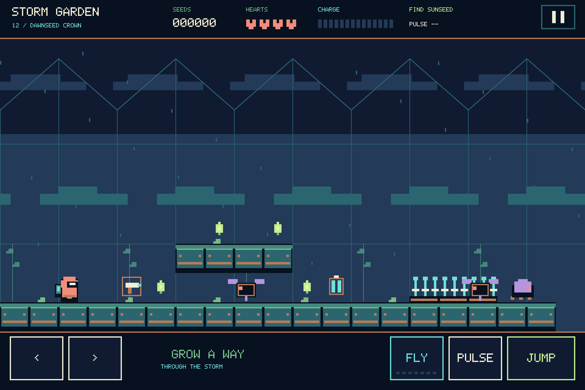
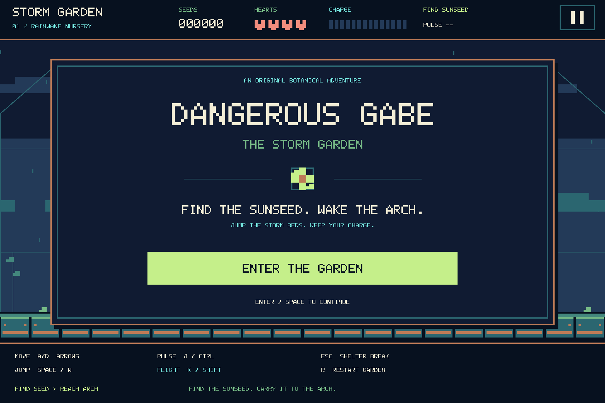
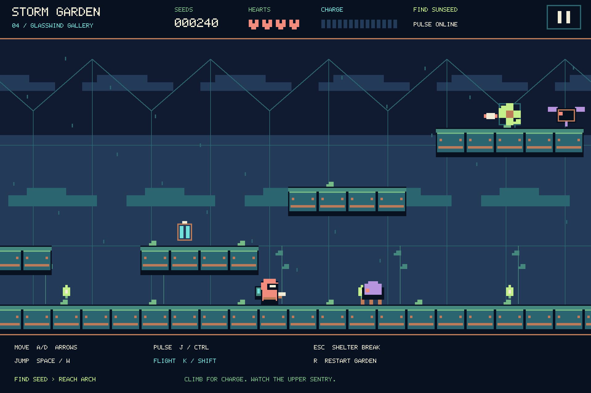
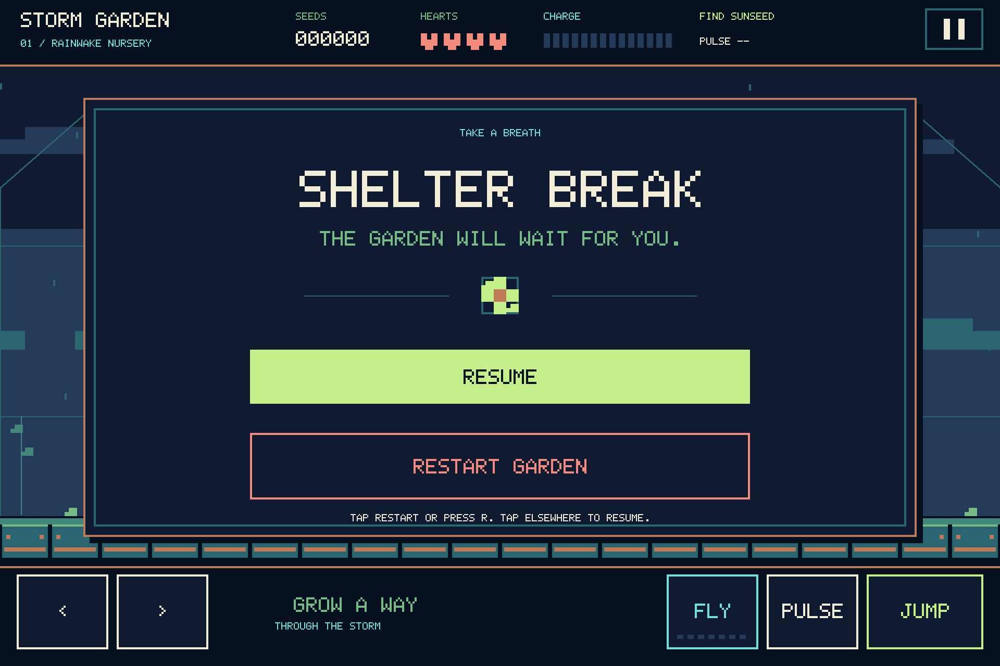

# Dangerous Gabe: The Storm Garden

An independent platform adventure written in Rust with SDL3. Explore a twelve-stage journey through floating gardens and the outer stormworks, recover their sunseeds and carry each one to its exit arch. The game includes original procedural artwork, custom Trellis lettering, synthesized sound, keyboard and touch controls, and a campaign that builds from jumping and combat to carefully timed flight.

## Contents

- [Story](#a-gardener-above-the-clouds)
- [Screenshots](#screenshots)
- [Quickstart](#start-playing)
- [Twelve stages, rules and controls](#play-through-twelve-stages)
- [Platform builds and verification](#build-for-your-platform)
- [Contribute and module map](#contribute)
- [CI matrix](#ci-matrix)
- [Release all platforms](#release-all-platforms)
- [Architecture](#architecture)
- [Visual design](#visual-design)
- [Roadmap](#roadmap)
- [Validation appendix](#validation-appendix)
- [Documentation layout](#documentation-layout)
- [Dependency references](#dependency-references)

## A gardener above the clouds

Gabe knows the floating greenhouses by their sounds: rain ticking against glass,
copper pipes settling after sunset, leaves brushing the nursery windows. These
gardens are his home, and keeping them alive is his work. Tonight, the familiar
sounds disappear beneath a storm. The planting beds crackle with stray current,
the skybridges have broken, and the mechanical tenders mistake their gardener
for an intruder.

The gardens still hold their sunseeds: bright living hearts that can wake the
arches linking one greenhouse to the next. Gabe pulls on his coral hood, checks
his capacitor pack and steps into the rain. He cannot repair the whole sky at
once. He can carry one sunseed to one arch, then reach the next garden.

The first six arches restore the inner gardens, but their answering light reveals a deeper fault: the outer infrastructure is still feeding the storm. The Eye of the Garden is the midpoint of Gabe's journey. He must follow the damaged network through foundry, aqueduct, relay and conservatory to the Starfall Engine, then carry the last sunseed into the Dawnseed Crown.

## Screenshots

The first image is a real SDL3 capture from the current twelve-stage macOS build. The three earlier captures below it belong to the preceding six-stage difficulty revision and remain historical. None of these images establishes a new Apple-mobile run.

**Dawnseed Crown: the twelfth garden, with touch controls shown on the current macOS build**



This is a selected-stage entrance capture, not an earned campaign completion. The route record below separately verifies uninterrupted play.

**Enter the garden**



**Glasswind Gallery: climb for charge while the upper sentry guards the sunseed**



**Touch controls and a pause menu with Resume and Restart Garden**



## Start playing

From the project directory, with Rust stable, a C/C++ toolchain and CMake installed:

```sh
cargo run --locked --release
```

The manifest declares Rust 1.85 as the minimum. Current local CI equivalents passed on native macOS with Rust stable 1.99.1; earlier native records used 1.87.0, and the initial Apple mobile builds used 1.99.1. See [platform setup](#build-for-your-platform) below for compilers, SDKs and development packages.

The default `vendored` feature builds and statically links SDL **3.4.18** from the locked dependency tree. The safe Rust wrapper is `sdl3 0.20.0`, with `sdl3-main 0.7.0` for SDL's callback lifecycle. A C compiler and CMake are needed even though the game is written in Rust. System platform libraries still apply. No original game installation, extracted assets, system font or SDL extension library is required.

If you already have a compatible SDL3 installation and pkg-config:

```sh
cargo run --locked --release --no-default-features --features system-sdl
```

## Play through twelve stages

Find the large **sunseed**, then enter the arch near the right end of each garden. Small seed motes and machine defeats add score but are optional. All twelve stages place tighter opposition around hazard approaches, jump commitments and landing ledges while keeping the initial spawn and sprayer approach safe. The sixth arch leads to stage seven; only the twelfth completes the campaign. In the table, C means crawler and S means sentry.

| Garden | What changes | Machines | Flight per cell |
| --- | --- | --- | --- |
| 1. Rainwake Nursery | A two-tile storm bed, a raised sunseed and a crawler guarding its ledge teach jumps and aimed pulses. | 2 (2C) | No cells |
| 2. Copper Canopy | Two storm beds, a two-tier seed climb, an upper-ledge crawler and the first firing sentry. | 3 (2C+1S) | No cells |
| 3. Cloudroot Lift | An eight-tile flight gap with a guarded landing/seed platform and threats along the exit route. | 4 (3C+1S) | 420 steps, 7 seconds |
| 4. Glasswind Gallery | Earn charge by climbing past a middle-trellis patrol, then approach the high sunseed under sentry fire. | 4 (2C+2S) | 260 steps, about 4.33 seconds |
| 5. Thunder Orchard | Two storm beds, nine- and four-tile crossings, an upper landing patrol and shorter charge. | 5 (3C+2S) | 150 steps, 2.5 seconds |
| 6. Eye of the Garden | The midpoint combines a refill between close ground threats, elevated sentries and nine- and five-tile crossings. | 6 (3C+3S) | 110 steps, about 1.83 seconds |
| 7. Ashglass Foundry | Eight- and seven-tile gaps, a low approach canopy and defended refill/seed terraces. | 7 (3C+4S) | 100 steps, about 1.67 seconds |
| 8. Lightning Aqueduct | Three seven-, seven- and six-tile spans between sentry-guarded landing/refill islands. | 8 (3C+5S) | 100 steps, about 1.67 seconds |
| 9. Blackthorn Relay | Eight-, seven- and six-tile gaps, a high seed ascent and descending crossings under overlapping fire. | 9 (3C+6S) | 95 steps, about 1.58 seconds |
| 10. Cyclone Conservatory | Eight-, eight- and seven-tile crossings around a three-tier roof climb and guarded descent. | 10 (4C+6S) | 95 steps, about 1.58 seconds |
| 11. Starfall Engine | Four seven-, eight-, seven- and six-tile gaps with alternating-height refills and defended landings. | 11 (4C+7S) | 90 steps, 1.5 seconds |
| 12. Dawnseed Crown | A wider four-crossing route, roof objective, the heaviest sentry mix and the shortest cells. | 11 (3C+8S) | 85 steps, about 1.42 seconds |

Dawnseed Crown keeps the same total of eleven machines as Starfall Engine, replacing a crawler with a sentry while widening the route and reducing charge. Difficulty rises through threat placement, height, crossings and resource pressure rather than enemy count alone.

### Garden stories and route guide

<details>
<summary>Follow Gabe through twelve stages, from the inner nursery to the Dawnseed Crown</summary>

#### 1. Rainwake Nursery

Gabe starts where he usually begins his morning rounds: beside the youngest
plants. Getting this little nursery breathing again gives him a reason to
believe the rest of the gardens can survive the night.

The nursery teaches Gabe to trust his boots before his backpack. Hop onto the
low planting platforms, collect the pulse sprayer near the entrance and jump
over the two-tile electrical storm bed. The sunseed rests on a raised platform farther
right, with a crawler on that same ledge. Clear its patrol before committing to the landing; a second crawler guards the approach to the arch. There is no flight
refill here: movement, jumping and a well-aimed pulse are your starting tools.

#### 2. Copper Canopy

Gabe recognizes the copperwork overhead; he has patched those pipes through
more rainy seasons than he can count. Tonight, the machines he once tended
block his way. Saving the canopy means finding a path through his own workshop.

The copper walkways carry two separate two-tile storm beds, with a crawler between them
and a sentry farther along the route. The sunseed sits higher than in the
nursery, above a pair of raised planting platforms. A second crawler patrols beside that upper sunseed, making the last jump a guarded landing. Climb by jumping between
platforms, then plan your descent around the electrical beds and the sentry's
horizontal shots. This garden also has no flight refill.

#### 3. Cloudroot Lift

Roots hang over the place where a walkway used to be. Gabe cannot mend the
missing span tonight, but the garden on its far side still needs him. For the
first time, he must trust the charge on his back as much as the ground below.

Here the floor breaks away into an eight-tile gap that requires flight. Collect
the capacitor cell, then clear a two-tile storm bed and an approach crawler
before committing to the crossing. The sunseed waits on a raised platform
beyond the gap, with another cell nearby and a crawler guarding its landing platform. A sentry threatens the route below
and another crawler patrols closer to the exit: four machines in all. Each
cell provides seven seconds of flight. Release flight when you can safely
land; holding it down spends the reserve even when you do not need more lift.

#### 4. Glasswind Gallery

The gallery once caught the first light above the clouds. Now its highest
sunseed is the brightest thing behind the glass. Gabe follows that small light
upward, carrying the hope of the lower gardens into the rafters.

The sunseed shines near the roof, above a staircase of planting platforms.
First climb to the capacitor cell on the trellis; flight must be earned by
reaching it. Its charge lasts about 4.3 seconds, less than in Cloudroot Lift.
A crawler patrols the middle trellis before an upper sentry threatens the high seed approach, adding close combat to the
climb. Another crawler below, a three-tile storm bed and a sentry near the exit
make the descent dangerous too. Four machines cover the floor, middle ledge and upper route.

#### 5. Thunder Orchard

The orchard is the part of the garden Gabe most wants to see in daylight again.
Its broken skybridge makes the distance feel enormous. He checks his charge,
looks toward the planting beds beyond the gap and commits to the crossing.

An early sentry, two two-tile storm beds and an approach crawler lead toward a
nine-tile flight gap. Each cell now gives only 2.5 seconds of flight, so use lift carefully and
coast into the landing rather than holding it throughout the journey. The
sunseed rests on the raised platform beyond the gap, now guarded by an upper landing patrol, with another cell on the
lower route there. A sentry, a second four-tile gap and a landing crawler still
separate Gabe from the arch. Five machines and two crossings demand a plan
for the return to ground; use a jump for the smaller gap and conserve charge
for when you need it.

#### 6. Eye of the Garden

Five arches are awake behind him. At the Eye of the Garden, Gabe expects the weather to ease. Instead the restored glass catches a line of light running beyond the inner greenhouses. The damage has a source, and the garden's own outer machinery is carrying it inward. Saving his home now means following that line.

This midpoint combines the inner gardens' lessons with cells lasting about 1.8 seconds each. An early cell leads into a three-tile storm bed and two close crawler patrols. The next cell sits between those ground threats and an approach sentry before a nine-tile flight gap. Land and climb to the elevated refill before taking the two-tier route to the sunseed. Two elevated sentries threaten that ascent, and a five-tile crossing leads toward a crawler and the arch. Six machines, two gaps and staged refills prepare Gabe for the outer stormworks.

#### 7. Ashglass Foundry

The foundry once shaped the panes that kept the nursery warm. Its dark glass now reflects six small lights behind Gabe, each one a garden he has brought back. He follows the copperwork through the old workshop, carrying a living sunseed where heat and machinery used to do the tending. Restoring this arch is his first step beyond the home he knows.

**Challenge guide:** A low canopy covers the approach to the first eight-tile gap. Reach the landing trellis for a refill, then climb to another cell and the elevated sunseed while sentries guard the trays. A seven-tile gap, a storm bed and exit-side machines still lie ahead. Each cell supplies 100 steps, about 1.67 seconds, so make each landing part of the route.

#### 8. Lightning Aqueduct

The aqueduct carried water through the floating gardens long before Gabe learned their paths. Tonight its glass channels hold the storm's reflection instead of the dawn. Following them outward, he begins to understand how a fault in one place can travel through every place that depends on it. Another sunseed, another arch: keep the line alive without letting its damage follow him home.

**Challenge guide:** Cross three missing spans of seven, seven and six tiles. The landing trellises carry cells and shooting sentries, making each refill a position to earn. The sunseed waits on the final raised tray, with more opposition between it and the arch. Cells still supply 100 steps each; aim for a controlled landing before the next crossing.

#### 9. Blackthorn Relay

Blackthorn has grown around the relay's copper ribs. Gabe remembers pruning it when the tenders still knew his footsteps. The relay links the inner gardens to the outer works; its silence explains why the warning never reached the nursery. He threads a living light through the place that should have carried the message, tending the connection one arch at a time.

**Challenge guide:** The first eight-tile crossing leads to an ascending route of trellises, elevated refills and a high sunseed. Sentries cover the climb while a crawler patrols below. After collecting the seed, descend toward a ground refill before the seven- and six-tile crossings. Cells now supply 95 steps, about 1.58 seconds, so height and safe landing space matter together.

#### 10. Cyclone Conservatory

The conservatory was built for the plants that needed the open sky. Gabe finds them bowed beneath a sky that will not stop moving. Eleven kinds of leaf once grew here, each bending differently in a gentle wind; tonight they all point toward the same dark center. He brings the next sunseed forward because a garden built to meet the weather must also be given a chance to survive it.

**Challenge guide:** Climb through three elevated tiers to the roof-level cell and sunseed after the first eight-tile crossing. Sentries guard upper lanes, while the later eight- and seven-tile gaps require a descent to staged landing refills. Keep the 95-step cell limit in mind before leaving an upper platform; clear the next lane and commit to a reachable landing.

#### 11. Starfall Engine

In the engine house, the storm sounds almost regular. Gabe hears the same broken rhythm that reached the nursery beneath the rain. This is the machinery that should have balanced the outer works, carrying the fault through the network instead. The seed in his hands is small beside it, but he has learned that a place does not need a grand rescue to begin working again.

**Challenge guide:** Four crossings of seven, eight, seven and six tiles alternate with elevated cells and sentry-guarded trays. A higher refill interrupts the route between the middle spans, and the sunseed rests beyond that climb. Cells give only 90 steps, or 1.5 seconds: trade stored height for distance, fire before crossing into a guarded lane and reach the next refill before spending more charge.

#### 12. Dawnseed Crown

At the crown, the sky begins to pale. The restored inner gardens are only points of light below Gabe, but together they trace every step that brought him here. The last sunseed belongs in the crown's exit arch, where the outer network can answer the gardens instead of feeding the storm. He carries it down from the roof and across the remaining spans as a gardener finishing his rounds: careful, tired and unwilling to leave one living place behind.

**Challenge guide:** This is the campaign's true finale. Four crossings of eight, eight, eight and seven tiles surround a climb to the roof seed, with elevated cells and sentries along the ascent. The 85-step cells provide about 1.42 seconds of thrust each. Prepare the approach, land for each staged refill and save enough height to carry the dawnseed across the remaining spans. The 84-tile route ends with a solid apron leading to the arch, guarded by the final sentry. Eleven machines include eight sentries, increasing ranged pressure beyond the previous stage.

#### When the last arch wakes

The Dawnseed Crown wakes. The outer stormworks answer the twelve restored arches, and the fault that fed the storm finally breaks. Across the floating greenhouses, small lights find one another through thinning rain. Gabe has kept his home alive by following the work all the way to its source.

The victory screen gives that work its name: **THE SKY IS ALIVE.**
**THE STORM HAS A GARDENER.**

</details>

### Pickups, charge and lives

| Object | Effect |
| --- | --- |
| Small seed mote | Adds 80 points; optional for completing a garden |
| Sunseed | Adds 300 points and unlocks the garden's arch |
| Pulse sprayer / blaster | Enables horizontal shots in Gabe's facing direction |
| Capacitor cell | Sets charge to that garden's allowance |
| Exit arch | Awards 750 points plus a remaining-charge bonus when entered with the sunseed |

Crawlers patrol the floor; sentries face Gabe and fire horizontal shots when nearby. A pulse removes either machine for 120 points. A brief flashing grace period protects Gabe from contact damage after a fresh start.

A capacitor cell **sets** charge to its garden's allowance; cells do not stack. Hold flight for upward thrust and release it to conserve charge. Landing or waiting does not refill the pack. The charge gauge still shows the full 420-step (seven-second) maximum, so later cells fill only part of it. Inner stages three through six supply **420 / 260 / 150 / 110 steps** per cell at 60 updates per second. Outer stages seven through twelve supply **100 / 100 / 95 / 95 / 90 / 85 steps**. Charge, movement, gravity and scoring rules remain consistent across the campaign.

Gabe begins with **four lives**. Storm beds, falls, machine contact and sentry shots cost a life; jumping on enemies is not an attack. A failed attempt resets the current garden's pickups, machines, tools and entry score. Voluntary restart performs the same reset without spending a life. Score and lives carry between gardens, but tools, charge and the sunseed reset. A sprayer enables repeated horizontal shots without an ammunition counter.

The ordinary-input route runner completes all twelve selected stages and an uninterrupted campaign at **Victory, score 25711, four lives**, with the last arch reached at playing tick **7482**. The sixth arch is reached at tick 2152 with score 11463 and continues into Ashglass Foundry. These are reachable routes, not a measure of human difficulty. The earlier six-stage scores 10863 and 10455 remain historical. [Recorded campaign validation](#campaign-validation) records the challenges, routes and checks.

### Keyboard and touch

| Action | Keyboard | Touch |
| --- | --- | --- |
| Move left / right | Hold **A / D** or **Left / Right Arrow** | Hold the left/right pads |
| Jump | Press **Space**, **W** or **Up Arrow** while grounded; release before the next jump | Tap **Jump** |
| Fire pulse sprayer | Press or hold **X**, **J**, **Left Ctrl** or **Right Ctrl** after collecting it | Tap or hold **Pulse** |
| Capacitor flight | Hold **Left Shift**, **Right Shift**, **Z** or **K** while charged | Hold **Fly** |
| Start, continue, or play again after victory/defeat | **Enter** or **Space** | Tap the title, clear, victory or defeat screen |
| Pause / resume | **P** or **Escape** | Upper-right pause control |
| Resume while paused | **Enter** or **Space** also resumes | **Resume**, or tap outside **Restart Garden** |
| Restart the current garden | **R** during play or pause | Pause, then **Restart Garden** |
| Quit | **Q** or close the window from any screen | Leave through the operating system |

Space jumps only during play and confirms on other screens. Enter does not jump. P and Escape pause or resume; they do not quit or return to the title. R retries during play or pause; after defeat, use Enter or Space to begin a new campaign. Clear screens also advance automatically.

Touch supports simultaneous fingers for movement, jumping, firing and flight. Controls use the same letterboxed coordinates as the scene, including window resizing and high DPI displays. Losing focus or entering the background pauses gameplay and clears held input. Use `--touch` on desktop to show the touch layout.

## Build for your platform

Commands below run from the directory containing [Cargo.toml](Cargo.toml). They describe supported build paths; the verification table distinguishes observed results from paths awaiting validation.

### macOS

Prerequisites: Rust through rustup, Xcode Command Line Tools or full Xcode, and CMake. With Homebrew available:

```sh
xcode-select --install
brew install cmake
rustup update stable
bash platform/desktop-build.sh
./target/release/dangerous-gabe
```

Skip `xcode-select --install` if Apple developer tools are already configured. The script builds for the host: `aarch64-apple-darwin` on Apple Silicon or `x86_64-apple-darwin` on Intel. The observed native host was Apple Silicon.

For an explicit Apple Silicon target:

```sh
rustup target add aarch64-apple-darwin
cargo build --locked --release --target aarch64-apple-darwin
```

An Intel or universal macOS release additionally needs a matching target, SDK/compiler support and separately built architecture slices. The desktop build script produces an executable. The [release workflow](#release-all-platforms) separately packages arm64 and Intel app bundles with ad hoc signatures; Developer ID signing and notarization remain separate work.

### Windows x64

Prerequisites on a Windows host: Rust through rustup, **Visual Studio C++ Build Tools with the Desktop development with C++ workload**, a Windows SDK, and CMake on PATH. Open a developer PowerShell with the MSVC build environment, then run:

```powershell
rustup target add x86_64-pc-windows-msvc
powershell -NoProfile -ExecutionPolicy Bypass -File .\platform\windows-build.ps1
.\target\x86_64-pc-windows-msvc\release\dangerous-gabe.exe
```

The script runs `cargo build --locked --release --target x86_64-pc-windows-msvc`. Default SDL3 linkage is static, so that build does not require a separate SDL3.dll; Windows runtime and system dependencies still apply. The Windows path is configured but has not been built or run in the recorded validation.

### Linux

Prerequisites: Rust through rustup, a C/C++ compiler, CMake, pkg-config and development packages for the desired display and audio backends. On Debian/Ubuntu:

```sh
sudo apt-get update
sudo apt-get install -y build-essential cmake pkg-config \
  libx11-dev libxext-dev libxrandr-dev libxcursor-dev libxi-dev \
  libxfixes-dev libxss-dev libwayland-dev libxkbcommon-dev \
  libasound2-dev libpulse-dev libudev-dev
bash platform/desktop-build.sh
./target/release/dangerous-gabe
```

The script uses the installed host target, commonly `x86_64-unknown-linux-gnu` or `aarch64-unknown-linux-gnu`. Run in a graphical session to exercise the real display and audio backends. Package names and optional backends vary by distribution; see [SDL's Linux dependency list](https://wiki.libsdl.org/SDL3/README-linux). Linux execution remains unverified here.

### iPhone and iPad

Use a **Mac with full Xcode**, accepted Xcode license, installed iOS platform SDKs, CMake and Rust through rustup. The supplied device path targets `aarch64-apple-ios`; the supplied simulator path targets `aarch64-apple-ios-sim` and requires an **Apple Silicon Mac**. An Intel simulator target is not implemented by these scripts.

```sh
rustup target add aarch64-apple-ios aarch64-apple-ios-sim
bash platform/ios-build.sh device
bash platform/ios-build.sh simulator
```

These are Mac-to-iOS cross builds. The [script](platform/ios-build.sh) selects the device or simulator SDK, sets minimum iOS **15.0**, passes the [iOS CMake toolchain](platform/ios.cmake) and packages [Info.plist](platform/Info.plist). The same app declares iPhone and iPad device families, with landscape orientations.

| Build | Output | Signing |
| --- | --- | --- |
| Device | `target/aarch64-apple-ios/release/bundle/DangerousGabe.app` | Unsigned |
| Apple Silicon simulator | `target/aarch64-apple-ios-sim/release/bundle/DangerousGabe.app` | Ad hoc signed by the script |

To install and launch on either an iPhone or iPad simulator, choose a shutdown device's UDID from the first command and enter it at the prompt:

```sh
xcrun simctl list devices available
printf 'Simulator UDID: '
read -r GABE_SIMULATOR_ID
xcrun simctl boot "$GABE_SIMULATOR_ID"
xcrun simctl bootstatus "$GABE_SIMULATOR_ID" -b
xcrun simctl install "$GABE_SIMULATOR_ID" target/aarch64-apple-ios-sim/release/bundle/DangerousGabe.app
xcrun simctl launch "$GABE_SIMULATOR_ID" dev.dangerousgabe.game
```

Skip the boot command for an already booted simulator. Choose an explicit UDID when several simulators are running. For a bounded run, append `--smoke` to the launch command; use `simctl launch --console` to see its result. The iPhone and iPad use the same simulator bundle.

Installing on a physical device requires your Apple signing identity, matching provisioning profile, bundle identifier and device deployment through Xcode or Apple's tools. The build script produces an unsigned device bundle. The [release workflow](#release-all-platforms) can additionally sign a registered-device IPA when its Apple secrets are configured. Physical-device execution, real credential signing and App Store distribution have not been verified; store submission remains separate work.

If Homebrew Rust and rustup coexist, ensure `cargo` and `rustc` come from the same rustup toolchain. On the recorded host, this meant prefixing the iOS script with `env PATH=/opt/homebrew/opt/rustup/bin:$PATH`. A desktop Rust standard library cannot substitute for an iOS target.

### Cross-compilation boundaries

Adding a Rust target installs its standard library, not its native linker, operating system SDK or SDL development dependencies. The iOS scripts supply the Apple SDK/CMake selection for their supported targets. There is no supplied Windows-from-macOS or Linux-from-macOS cross-toolchain script.

A Windows MSVC cross build needs the MSVC linker and Windows SDK. A Windows GNU cross build needs MinGW plus matching SDL CMake configuration. A Linux cross build needs the target linker, Linux sysroot and matching display/audio development libraries. Prefer native builds or CI on the destination operating system until those cross toolchains are configured and tested.

### What has actually been verified

| Target | Recorded evidence | Remaining limit |
| --- | --- | --- |
| macOS Apple Silicon | Current native CI equivalents: format/Clippy/release build, 33 library/integration cases and the twelve-stage route runner; separate Dawnseed Crown capture | Hosted CI, distribution packaging and notarization remain unverified; prepared fixtures are separate from earned gameplay |
| Windows x64 | Build script and native CI job supplied | No recorded build or run |
| Linux | Host build script, dependency instructions and native CI job supplied | No recorded build or run |
| iPhone simulator, iOS 26.2 | Initial integration: iPhone 17 Pro, 180 rendered frames and actual game screenshot | Apple build/run was not repeated after the earlier six-stage difficulty revision or this expansion |
| iPad simulator, iOS 26.2 | Initial integration: iPad Pro 13-inch (M5), 180 frames and actual pause-screen screenshot | Apple build/run was not repeated after the difficulty revision |
| iPhone/iPad device arm64 | Initial release executable and unsigned universal-family app bundle built | No provisioning, signed install or physical-device run |

The initial simulator runs logged UIKit appearance-transition warnings and then exited successfully. [Historical platform evidence](#historical-platform-validation) preserves those logs and historical captures; [campaign validation](#campaign-validation) covers the revised campaign. The [CI workflow](.github/workflows/build.yml) defines the [CI matrix](#ci-matrix); it has not been dispatched remotely. A dummy-driver run does not validate a real display or audio device.

## Contribute

Start from a local checkout, install the prerequisites above and run the game. Read [AGENTS.md](AGENTS.md) for ownership and repository constraints before changing shared files. Keep changes focused and preserve other contributors' work.

### Find the right module

| File | Responsibility |
| --- | --- |
| [src/simulation.rs](src/simulation.rs) | Deterministic gameplay; `World::step(Input)` advances one 60 Hz tick |
| [src/levels.rs](src/levels.rs) | Original stage layouts, threats, pickups and per-cell charge |
| [src/main.rs](src/main.rs) | SDL callback entry, frame timing, lifecycle and presentation |
| [src/platform.rs](src/platform.rs) | Keyboard, mouse/touch mapping, latched action edges and coordinate conversion |
| [src/platform/tests.rs](src/platform/tests.rs) | Input regressions |
| `tests/simulation.rs` | Public simulation/content integration tests |
| `tests/cli.rs`, `tests/support/` | Bounded SDL subprocess tests and test-only process helpers |
| [tools/runtime_routes.rs](tools/runtime_routes.rs) | Ordinary-input campaign runner, registered as Cargo test `campaign_routes` |
| [src/presentation.rs](src/presentation.rs) | Original geometry, camera, HUD and menus |
| [src/lettering.rs](src/lettering.rs) | Original Trellis bitmap lettering |
| [src/sound.rs](src/sound.rs) | Procedural SDL audio cues |
| [src/options.rs](src/options.rs) | Bounded runs and capture arguments |
| [src/lib.rs](src/lib.rs) | Library modules and testable boundary |
| [build.rs](build.rs), [platform/](platform/) | Apple linker support, SDK selection and packaging |
| `tools/release/`, `release.config.mjs` | Version planning, metadata stamping, native archives, manifest validation and semantic-release publication |

Keep the simulation and level content free of SDL and platform calls. SDL owns rendering, input and audio through the safe wrapper; rendering borrows the world. Preserve the fixed timestep and main-thread resource ownership. [Architecture](#architecture) explains the callback bridge and error boundaries.

### Check a change

Run the checks relevant to your change from the project root:

```sh
cargo fmt --all -- --check
cargo check --locked
cargo clippy --locked --all-targets -- -D warnings
cargo test --locked --lib --test simulation --test campaign_routes
cargo build --locked
```

The ordinary-input route runner is registered as Cargo's `campaign_routes` test target, with its existing `main` and `harness=false`. It verifies all twelve selected stages, uninterrupted progression, selection bounds, pause/retry, fuel exhaustion and defeat recovery. Run it alone with:

```sh
cargo test --locked --test campaign_routes
```

That command also works in Windows PowerShell. The pure Rust route source can alternatively run without building the SDL package dependencies:

```sh
rustc --edition 2024 tools/runtime_routes.rs -o target/gabe-runtime-routes
./target/gabe-runtime-routes
```

The preceding Cargo build creates `target/`. On Windows, give the standalone executable an `.exe` suffix. The runner opens no SDL window and uses ordinary logical input rather than assigning score or teleporting the player. Cargo still builds the package dependency graph when running its test target.

The CLI suite launches bounded child processes with dummy display/audio drivers. CI runs it on Linux:

```sh
SDL_VIDEO_DRIVER=dummy SDL_AUDIO_DRIVER=dummy cargo test --locked --test cli
```

Release tooling needs **Node 24.15 or newer** (CI selects the latest Node 24), Git and native archive tools. Install the private, locked development dependencies and run fixture tests with:

```sh
npm ci --ignore-scripts
npm test
```

The tests use temporary local Git repositories and fixture packages. They do not publish a release. The private npm package grants no license to the game; no npm publishing plugin is configured.

The full suite uses Unix `zip`, `unzip` and `tar` for aggregation/publication fixtures. Windows CI runs the portable planning, stamping, desktop-packager and Apple-metadata tests instead:

```powershell
node --test tools/release/orchestration.test.mjs tools/release/version.test.mjs tools/release/package-desktop.test.mjs tools/release/ios-metadata.test.mjs
```

Keep the SDL callback executable's `test=false`. Use the explicit test selections above; `cargo test --all-targets` can select the callback binary despite that default and is not the CI test command. Clippy's `--all-targets` checks compilation without executing those targets. Default CI uses vendored SDL3; `--all-features` also enables system-SDL discovery and requires appropriate pkg-config/system-library setup.

For an SDL shell check or visual change, also exercise the real window and capture the affected scene:

```sh
cargo run --locked -- --smoke
cargo run --locked -- --scene play --level 11 --touch --frames 120 --screenshot target/gabe-final.bmp
```

Capture options: `--scene title|play|pause|clear|win|lose`, zero-based `--level 0..11` for the expanded campaign, positive `--frames N`, `--touch`, and `--screenshot PATH.bmp`. A screenshot defaults to one frame unless a frame count or smoke mode is supplied; smoke defaults to 180 frames. To play a selected garden, combine `--scene play --level N`: `--level N` alone leaves the title screen active, and starting a new campaign returns to garden one. There is no `--help` flag.

Save to a writable location; iOS paths must be inside the app sandbox. Export produces BMP files; the README images were converted to PNG after capture. Scene selection is a visual review aid and does not prove gameplay progression.

### Original content and a useful handoff

All game code, maps, visuals, lettering and audio are independently created. Contributions must use independently created material or third-party material with an explicit compatible license and recorded provenance. The project does not need a neighboring checkout or proprietary content to build.

When sharing a contribution, explain the player-visible result, affected modules, checks actually run and their outcomes. For visual changes, include a real screenshot; for platform claims, record the exact target, command and observed result. Update the story, controls, design notes or verification records when behavior changes. Keep credentials, certificates and provisioning profiles out of the repository. No LICENSE file is currently included; do not assume a license grant.

### CI matrix

The [workflow](.github/workflows/build.yml) runs on pushes, pull requests, manual dispatch and reusable `workflow_call` from the release workflow. Native Rust jobs use stable with rustfmt and Clippy, Cargo caching, read-only repository permissions and a 20-minute timeout. A new run cancels an older CI run for the same workflow/ref.

| Job | Gates and test targets |
| --- | --- |
| macOS, Windows, Linux native matrix | Format check, default-vendored Clippy with warnings denied, release build, then library input tests, `simulation` integration tests and `campaign_routes` ordinary-input campaign |
| Linux native job, CLI step | `cli` process-level tests with `SDL_VIDEO_DRIVER=dummy` and `SDL_AUDIO_DRIVER=dummy` |
| macOS iOS compilation job | Both supplied device and simulator build/package scripts, with both Rust targets installed, Cargo caching and a 30-minute timeout |
| Node release tooling, Ubuntu/macOS/Windows | Node 24 and locked npm installation; full suite on Unix publishing/Apple hosts, version/planning/desktop/Apple-metadata fixtures on Windows; 10-minute timeout |

The native suite intentionally selects `--lib --test simulation --test campaign_routes`; the CLI step selects only `--test cli`. The campaign runner is part of normal Cargo target discovery through its manifest registration. No duplicate standalone route command is needed in CI. The suites contain six library input regressions, seventeen simulation integration tests and ten bounded CLI cases, plus the custom ordinary-input campaign executable. A combined local run passed on Apple Silicon with Rust stable and default vendored SDL3, including the CLI suite; [the exact record](#ci-configuration-and-local-validation) is below. Windows, Linux, fresh iOS compilation and hosted CI were not run as part of that validation.

## Release all platforms

The [Release all platforms workflow](.github/workflows/release.yml) provides a manual release option after a change reaches the default branch. It reuses all CI gates, plans a version with the semantic-release JavaScript API, packages every required platform at that source SHA and stamped version, then validates and publishes them in one job. It does not rely on a tag push starting another workflow: [events caused by `GITHUB_TOKEN` generally do not start new workflow runs](https://docs.github.com/en/actions/how-tos/write-workflows/choose-when-workflows-run/trigger-a-workflow).

### Set up GitHub and run a release

1. Place the project at the root of your own GitHub repository, including `.github/workflows/`, Cargo files and locked npm tooling. This local directory is not currently a Git repository; no repository, remote URL, hosted run, tag or release was created here.
2. Enable Actions and allow the release jobs to write repository contents. The built-in `GITHUB_TOKEN` is supplied to planning/publication steps. Branch protection/rulesets must permit that identity to push the metadata release commit and tag. If policy instead requires an authorized GitHub App/token, configure checkout credentials and the semantic-release token together. Do not implicitly bypass required reviews. Even dry-run planning [verifies push permission](https://semantic-release.org/usage/configuration/).
3. Optionally configure the Apple secrets below. Without them, both required unsigned-device and ad hoc simulator archives are still produced.
4. Open **Actions -> Release all platforms -> Run workflow**, select the **default branch** and choose `auto`, `patch`, `minor` or `major`. Other branches fail the guard. Release runs are serialized and do not cancel an active release.
5. Review the jobs and, after success, the GitHub release assets and generated notes. A failed CI/build/package/manifest gate prevents publication. If the default branch moves during the run, dispatch again against its new head.

| Selection/change since the last `vVERSION` tag | Result |
| --- | --- |
| `auto`: `fix:` or `perf:` | Patch |
| `auto`: `feat:` | Minor |
| `type!:` or a `BREAKING CHANGE:` footer | Major |
| `auto`: only `docs:`, `test:` or other non-release changes | No release |
| Explicit `patch`, `minor` or `major` | At least that bump, including docs/test-only changes; a larger inferred bump wins |
| First release without a release tag | semantic-release starts at **1.0.0**, independent of the current Cargo development version |

The planner uses semantic-release itself. Publication repeats the dry run and refuses a changed version, source SHA, branch, requested type or build number. Its prepare hook validates all assets again and synchronizes `Cargo.toml`, the root package in `Cargo.lock` and both version fields in `platform/Info.plist`. `@semantic-release/git` commits only those files as `chore(release): VERSION [skip ci]`. Packages identify the original tested source commit; the tag points at its metadata-only release commit. `github.run_number` supplies the positive Apple build number. Release notes live in the GitHub body; no changelog document or npm package is published.

### Required release assets

All seven archives are mandatory, with embedded version/target/signing/source metadata and third-party notices. Desktop archives also include this guide; macOS archives contain an app bundle. Labels below follow [GitHub's native runner reference](https://docs.github.com/en/actions/reference/runners/github-hosted-runners).

| Platform | Native runner | Asset (`V` = planned version) |
| --- | --- | --- |
| macOS Apple Silicon | `macos-15` | `dangerous-gabe-V-aarch64-apple-darwin.zip` |
| macOS Intel | `macos-15-intel` | `dangerous-gabe-V-x86_64-apple-darwin.zip` |
| Windows x64 | `windows-latest` | `dangerous-gabe-V-x86_64-pc-windows-msvc.zip` |
| Linux x64 | `ubuntu-24.04` | `dangerous-gabe-V-x86_64-unknown-linux-gnu.tar.gz` |
| Linux arm64 | `ubuntu-24.04-arm` | `dangerous-gabe-V-aarch64-unknown-linux-gnu.tar.gz` |
| iPhone + iPad arm64 | `macos-15` | `dangerous-gabe-V-ios-iphone-ipad-unsigned.zip` |
| Apple Silicon iOS simulator | `macos-15` | `dangerous-gabe-V-ios-simulator-arm64.zip` |

The publisher rejects missing, duplicate, malformed, wrong-version or wrong-source archives, writes `SHA256SUMS.txt` and `release-manifest.json`, and attaches them with the packages. Checksums establish file identity, not Apple trust. Windows/Linux still require their OS runtime/display/audio dependencies. macOS apps are ad hoc signed, without Developer ID signing or notarization.

### Optional signed iPhone/iPad IPA

Configure **all five** secrets for the device packaging step:

| Secret | Value |
| --- | --- |
| `GABE_IOS_CERTIFICATE_BASE64` | Base64 `.p12` identity export including the private key |
| `GABE_IOS_CERTIFICATE_PASSWORD` | Password protecting that `.p12` |
| `GABE_IOS_PROVISION_PROFILE_BASE64` | Base64 matching provisioning profile |
| `GABE_IOS_SIGNING_IDENTITY` | Signing certificate's 40-character SHA-1 fingerprint |
| `GABE_IOS_TEAM_ID` | Apple Developer team ID matching the profile |

Partial configuration fails. The helper stages a copy, checks bundle/profile/certificate/entitlements, uses a temporary keychain and cleans up credentials. The optional `dangerous-gabe-V-ios-iphone-ipad.ipa` targets the devices/distribution allowed by a development, ad hoc or enterprise profile; registered-device profiles must include the intended device IDs. The unsigned ZIP remains available. **An unsigned device bundle is not directly installable.** Simulator archives run in the simulator, not on a physical device.

No real credential signing or physical installation has been verified. This is not an App Store Connect/TestFlight upload; store distribution needs the appropriate Apple account, assets, archive/export and submission. See [GitHub's signing guide](https://docs.github.com/en/actions/how-tos/deploy/deploy-to-third-party-platforms/sign-xcode-applications), [Apple's profile details](https://developer.apple.com/documentation/technotes/tn3125-inside-code-signing-provisioning-profiles) and [ad hoc requirements](https://developer.apple.com/help/account/provisioning-profiles/create-an-ad-hoc-provisioning-profile/).

### Release tooling commands

These workflow building blocks run from a clean Git checkout with the real default-branch/source environment. Planning requires GitHub authorization. `npm run release:publish` is the external publication command, not a local check.

```sh
npm ci --ignore-scripts
npm test
npm run release:plan
node tools/release/version.mjs VERSION BUILD_NUMBER
node tools/release/package-desktop.mjs --target TARGET --version VERSION --binary PATH --output dist
node tools/release/package-ios.mjs --kind device --app PATH.app --version VERSION --output dist
node tools/release/package-ios.mjs --kind simulator --app PATH.app --version VERSION --output dist
node tools/release/manifest.mjs --version VERSION --directory dist
```

Replace uppercase placeholders with planned values and native output paths. Generated `release-plan.json`, `dist/` and `node_modules/` are ignored. Publication uses the wrappers and complete-asset validation; an individual helper does not prove a complete release. See the [release validation record](#release-tooling-validation) for observed results and dependency limitations.

## Architecture

`levels.rs -> simulation.rs <- main.rs -> presentation.rs / platform.rs / sound.rs -> SDL3`

The simulation and level builder use Rust's standard library without SDL or operating system calls. `World::step(Input)` advances exactly one 60 Hz tick. The shell owns wall time, caps catch-up after suspension and passes logical buttons into the world. `World` owns campaign progress, score, lives, player, pickups, enemies and shots; its modes are Title, Playing, Paused, LevelComplete, Victory and Defeat. The renderer borrows this state without changing it.

SDL3's `SDL_AppInit`, `SDL_AppEvent`, `SDL_AppIterate` and `SDL_AppQuit` entry points are generated by `sdl3-main` macros at the root of `main.rs`. Both desktop and iOS use this lifecycle, allowing UIKit to schedule frames instead of running a blocking game loop inside iOS main.

Windows, canvases and other thread-affine resources remain inside `MainThreadData<RefCell<App>>`. SDL can deliver events on another thread, so the event callback writes reduced events into a synchronized queue and never renders. The mutex is released before simulation, audio and rendering because SDL can deliver callbacks during those operations. Action edges remain latched until a simulation tick consumes them. Finger release/cancel removes only its matching ID; focus loss/background clears all held controls and pauses active play. Foreground returns to a paused game.

The rendering interface is `presentation::paint(&mut Canvas<Window>, &World, bool) -> Result<(), String>`, where the boolean enables touch visuals. Main owns presenting and optional frame export. The callback binary has `test=false`; testable modules live in the library so SDL's generated main does not replace Rust's test harness.

Audio uses an SDL3 playback stream with newly synthesized decaying sine pulses selected from world changes. The simulation stays silent and deterministic. Queued audio is bounded; failure to open or write an output stream disables audio while retaining play. Audible quality, interruption recovery and physical-device routing have not been independently verified.

The Apple build boundary consists of the supplied SDK/CMake script and `build.rs`. SDL's Objective-C availability checks need Apple's compiler-rt archive for the minimum iOS15 build. The build script locates the archive through `xcrun clang --print-resource-dir` and passes it directly to the binary linker; this also avoids embedding a universal native archive in a Rust rlib. Native SDKs, signing and packaging remain platform responsibilities.

## Visual design

### Branding website

The portable [game field guide](docs/html/index.html) extends the game's own visual language: a midnight greenhouse, copper structural lines, luminous seed accents and a coral gardener. Its signature is a large original Trellis wordmark above an actual game frame, with an expedition rail joining the twelve gardens. The website uses live HTML and SVG; screenshots illustrate the game rather than replacing the interface.

Website tokens inherit the palette below. Paper is body ink, Seed marks primary actions, Current marks route and charge information, and Copper frames media. Surfaces step from Ink to Midnight to Storm; translucent foliage, a radial seed glow, inset rims and restrained shadows give the greenhouse depth. System sans-serif body text and system monospace labels need no remote fonts. Display lettering is an SVG drawn from the original Trellis glyph data. The type scale is 12, 14, 16, 18, 24, 32, 48 and 72 pixels; spacing follows a 4-pixel base with 8, 12, 16, 24, 32, 48, 64 and 96-pixel steps. Content is bounded at 1280 pixels.

Reusable primitives are the seed action (default, hover, keyboard focus), copper text link, numbered route entry (closed/open native details), framed screenshot (thumbnail/full-size dialog), section eyebrow and platform ledger. Controls have at least 44-pixel targets and a visible Current focus outline. The route has two columns on wide screens and one below 760 pixels; the hero stacks below 960 pixels. Mobile navigation wraps instead of hiding links. Images retain their aspect ratio, all text remains selectable, and reduced-motion preferences remove decorative motion. The site intentionally keeps the game's dark palette in both operating-system color modes.

Build the static page with `node docs/html/build.mjs`; serve `docs/html/` with any static HTTP server. Edit `docs/html/site.config.json`, or set `GABE_REPOSITORY_URL` and `GABE_SITE_URL` when building, to provide real public HTTPS URLs. Unset URLs omit canonical and absolute sharing-image metadata, and the repository action leads to local build information. No placeholder public URLs are published. The generated HTML contains the complete story, stage guide and VideoGame structured data without JavaScript. JavaScript only enhances the screenshot viewer. The share image is original website branding combined with an actual game screenshot; screenshot captions distinguish the current twelve-stage capture from earlier integration captures. This is a local website artifact, not a deployed download service.

The garden uses midnight sky, glass arches, copper machinery and wind-bent foliage. Gabe's coral hood, dark visor, cream faceplate, boots and teal capacitor pack give him an original silhouette. Layered planting trays establish solid ground; bright seeds, electrical prongs, violet machines and open/closed arch shapes distinguish interactions beyond color alone. Keep decoration dimmer than the player, pickups and hazards.

<details>
<summary>Palette, lettering and exact logical layout</summary>

| Token | Hex | Role |
| --- | --- | --- |
| Midnight | `#101B32` | Outer sky and HUD |
| Ink | `#07111F` | Outlines and shadows |
| Storm | `#233A58` | Distant clouds and islands |
| Glass | `#2B6670` | Greenhouse glazing |
| Trellis | `#43877D` | Platform edges |
| Copper | `#BD7B57` | Machinery, pipes and bolts |
| Leaf | `#76BA86` | Safe surface accents and foliage |
| Seed | `#C5EF8A` | Collectibles and primary actions |
| Current | `#72E0DA` | Charge, active arches and flight effects |
| Coral | `#F28D7D` | Gabe's coat and urgent prompts |
| Orchid | `#B695DE` | Mechanical pests |
| Paper | `#F2EDD6` | Main lettering and face highlights |

The original Trellis alphabet in `lettering.rs` uses five-by-seven stencils with clipped corners and open counters. Capitals, lowercase aliases, digits and printable ASCII punctuation are covered; zero has a diagonal interior, and unknown characters show an outlined marker. `glyph(char)` returns seven five-bit rows, `measure(&str)` gives unscaled bounds, and `for_each_pixel(&str, callback)` emits lit coordinates including multiline layout. Advance is six pixels per glyph and ten per line. The renderer applies integer scales and color, using paper for primary text, seed for selected actions and cyan for supporting information. No game or system font is loaded.

The logical scene is **960 by 640**, using **24-pixel world tiles**, a 2x world view and a bounded camera that shows 480 world units horizontally. HUD occupies y=0..64, world y=64..544 and controls y=544..640. Clipping ends before the HUD and overlays are drawn. Letterboxing preserves scene coordinates across resizing and high DPI outputs.

Touch rectangles use logical `(x, y, width, height)` coordinates:

| Action | Rectangle |
| --- | --- |
| Left | `(16,552,88,72)` |
| Right | `(112,552,88,72)` |
| Fly | `(640,552,88,72)` |
| Pulse | `(736,552,88,72)` |
| Jump | `(832,552,112,72)` |
| Pause hit area | `(876,0,84,72)` |
| Visible pause icon | `(888,8,56,40)` |
| Paused Resume | `(240,336,480,52)` |
| Paused Restart Garden | `(240,416,480,64)` |

Fly includes charge cells. The pause hit area exceeds the visible icon without overlapping another active HUD control. A paused tap outside Restart Garden resumes. Physical safe-area accuracy and touch comfort still require device playtesting.

Implemented interface copy includes DANGEROUS GABE / THE STORM GARDEN, ENTER THE GARDEN, SHELTER BREAK, RESUME and RESTART GARDEN. Earlier editorial ideas such as Field Guide, Settings, Return to Title, ladders, mute controls and elaborate sustained audio are not implemented feature claims. Current sound is short procedural cues; richer seed chimes, a quiet capacitor hum and expanded sound options remain possible design work.

</details>

## Roadmap

Status recorded **2026-10-17**. The twelve-stage expansion, tighter opposition and ordinary-input verification are complete. Native build/check results belong to this revision; Apple observations still belong to the initial six-stage integration.

| Work | Status | Evidence or remaining work |
| --- | --- | --- |
| Safe Rust SDL3 shell and callback lifecycle | Complete | Pinned wrapper/main/SDL3 versions; native and initial Apple runs |
| Twelve-stage campaign and outer stormworks story | Complete | Tighter opposition across all twelve; selected routes and uninterrupted Victory25711 with four lives |
| Prior six-stage difficulty revision | Historical verification | Then-complete campaign reached Victory10863 with four lives |
| Original geometry, Trellis lettering and procedural cues | Complete | Native captures, renderer review; audio unavailable-device fallback |
| Keyboard, touch, fixed tick, pause and retry | Complete | Six input regressions and reviewed touch layout |
| Current twelve-stage native macOS build and checks | Complete | Format, locked check, Clippy, six input regressions and native build passed |
| iPhone/iPad simulator build and execution | Initial integration verified | 180 frames on both devices; revised campaign Apple runs pending |
| iPhone/iPad device release build | Initial integration verified | Unsigned arm64 app; signing and physical execution pending |
| Windows and Linux build/run | Pending | Native scripts and CI supplied; no recorded destination build/run |
| Cross-platform CI configuration | Complete; local native equivalents passed | Native format/Clippy/build/test matrix, Linux CLI tests and Apple compilation jobs; Windows/Linux and remote execution remain unverified |
| All-platform release automation | Implemented; hosted run pending | Semantic-release plan/build/validate/publish, seven mandatory archives and optional provisioned IPA; actual GitHub/Apple credential paths unverified |
| Store distribution and notarization | Pending | Developer ID/notarization, App Store assets/submission and physical-device execution |

Future work includes persistence, configurable bindings, controller support, more stages, accessibility options and expanded audio. These are planned possibilities, not shipped features.

## Validation appendix

All records below were captured on **2026-10-17**. The CI section records the combined local validation run; original twelve-stage runtime verification, prior six-stage campaign, initial platform runs and independent review retain their own scope and results.

### CI configuration and local validation

On 2026-10-17, `actionlint .github/workflows/build.yml` passed with actionlint 1.7.12. `cargo metadata --no-deps --format-version 1 --locked` accepted the `campaign_routes` target registration and confirmed the callback binary remains excluded from default tests. The manifest keeps `harness=false` for the existing route runner's main. The workflow was unchanged after that lint pass, so it was not linted again.

After both integration suites were ready, one combined local validation used **Apple Silicon macOS**, **rustc 1.99.1 (58cf8f9c3, 2026-10-13)** and **cargo 1.99.1 (5f94df478, 2026-08-27)** from rustup stable. Its rustfmt and Clippy components were installed first. The commands below passed with the default **vendored SDL3 3.4.18**, without enabling the system-SDL feature:

```sh
env PATH=/opt/homebrew/opt/rustup/bin:$PATH cargo +stable fmt --all -- --check
env PATH=/opt/homebrew/opt/rustup/bin:$PATH cargo +stable clippy --locked --all-targets -- -D warnings
env PATH=/opt/homebrew/opt/rustup/bin:$PATH cargo +stable build --locked --release
env PATH=/opt/homebrew/opt/rustup/bin:$PATH cargo +stable test --locked --lib --test simulation --test campaign_routes --test cli
```

| Target | Observed result | Coverage |
| --- | --- | --- |
| Library | 6 passed, 0 failed, 0 ignored | Input latches, key mappings, letterboxed touch, suspension and retry |
| `simulation` | 17 passed, 0 failed, 0 ignored | Stage content/bounds, fixed-step movement/collision/jump, objective/score, finite nonstacking charge, combat/damage/grace and pause/retry |
| `cli` | 10 passed, 0 failed, 0 ignored; 2.83 seconds | Deterministic smoke, stage 12 selection, four nonblank BMP scene exports and four invalid-argument cases |
| `campaign_routes` | Successful custom executable, exit 0 | All twelve selected routes, uninterrupted Victory score 25711 with four lives, sixth-stage continuation, final-only victory, selection bounds and control/recovery checks |

That is **33 library/integration cases plus the campaign executable**, all from one test invocation. The custom runner's stdout remained visible and its process status was handled directly by Cargo. Each CLI child used its own dummy display/audio environment, unique temporary directory and a 20-second watchdog with kill/reap cleanup. The CLI suite therefore passed locally with vendored SDL3 as well as its owner's earlier system-SDL run; it did not exercise the physical display or audio device.

No checks were suppressed, tests skipped or product source changed to pass these gates. The local workspace is not initialized as a Git repository; no Git initialization, commit, push or hosted workflow dispatch occurred. Windows/Linux jobs and new iOS package builds were not executed in this task. Earlier physical/simulator observations below are preserved as historical evidence, not revalidated by the dummy-driver tests.

### Release tooling validation

On **2026-10-17**, `npm ci --ignore-scripts` completed against the project lockfile. **Node 24.22.0** ran the final `node --test tools/release/*.test.mjs` suite on native Apple Silicon macOS: **56 passed, 0 failed, 0 skipped** in 7.63 seconds. This covers 18 orchestration cases, 19 Apple packaging/metadata cases, eight manifest cases, six desktop packaging cases, four version cases and one real local publication fixture. Node 24 was selected with `npx --yes --package=node@24 node --test tools/release/*.test.mjs`; the earlier 55-case suite also passed with Node 25.4.0. `actionlint .github/workflows/build.yml .github/workflows/release.yml` passed with actionlint **1.7.12** after the final workflow changes.

The orchestration tests invoke real semantic-release **25.0.9** dry runs in temporary local Git repositories for patch/minor/major/no-change/forced-docs/initial-1.0.0 planning. They verify a stale source, moved default branch, dirty checkout, version mismatch and missing asset prevent publication. A mock publisher confirms complete validation precedes exactly one non-dry-run invocation; downloaded ignored plan/assets are present in that fixture. The local publication fixture uses actual semantic-release prepare, `@semantic-release/git`, a local bare origin and all seven fixture archives to verify metadata-only commit and tag ordering, without a GitHub or npm publish plugin. Manifest tests cover embedded versions/signing/source metadata and SHA256 output. Apple signing commands, failures and credential cleanup use injected tools; those fixtures are not real provisioning evidence.

Separate local packaging observations used existing version **0.1.0/build 1** executables: the macOS arm64 `.app` archive passed plist and ad hoc signature validation at `target/release-check/dangerous-gabe-0.1.0-aarch64-apple-darwin.zip`; unsigned iPhone/iPad and simulator archives were produced from the existing Apple bundles, their embedded metadata was read successfully, and the extracted simulator app passed strict signature verification. The Apple executables belong to the historical initial integration; repackaging them does not establish a current twelve-stage Apple rebuild/run. Real IPA signing remains unverified.

Dependencies were selected from npm's published version/engine metadata: semantic-release 25.0.9, GitHub plugin 12.0.10, Git plugin 11.0.1, commit analyzer 13.0.1 and notes generator 14.1.1. The Git plugin requires Node >=24.15 on the Node 24 line; CI's Node 24 selection meets that minimum. [The semantic-release API](https://semantic-release.org/developer-guide/js-api/) supplies both plans and publication.

`npm audit --json` reported **eight high-severity entries** cascading from transitive `braces` 3.0.3 through micromatch/semantic-release. The [official GHSA-vfj7-8cjw-p6xm advisory](https://github.com/advisories/GHSA-vfj7-8cjw-p6xm) lists no patched version as of this record. It concerns stack exhaustion from deeply nested glob patterns; this release configuration uses fixed authored patterns and manual default-branch dispatch. No advisory was suppressed, dependency downgraded or audit-success claim made. Recheck upstream and the lockfile when a fix is available.

No real repository initialization, source commit, remote push, tag, GitHub release or hosted job was performed. Temporary fixture repositories are separate from this checkout. Real Windows/Linux packages, hosted runner availability, real Apple credential signing and release installation remain unverified. Earlier platform and campaign records below retain their own revisions.

### Campaign validation

The current twelve-stage results are recorded first. The earlier six-stage revision remains in its own historical record below.

<details>
<summary>Current twelve-stage campaign: locked source, routes and native checks</summary>

The locked source has `CAMPAIGN_LEN=12`, selected indices **0..11**, and widths **36 / 40 / 44 / 42 / 48 / 54 / 60 / 66 / 66 / 70 / 76 / 84** tiles. Every stage retains a safe initial spawn and sprayer approach. Earlier-stage opposition was tightened with a seed-ledge crawler in Rainwake, an upper-seed crawler in Copper, a landing crawler in Cloudroot, a middle-trellis crawler in Glasswind, an upper landing patrol in Thunder, and another close ground crawler around Eye's refill approach. New stages add early firing pressure, defended landing/refill islands and upper threat lanes.

Crawler/sentry splits are **2/0, 2/1, 3/1, 2/2, 3/2, 3/3, 3/4, 3/5, 3/6, 4/6, 4/7, 3/8**. Totals are **2 / 3 / 4 / 4 / 5 / 6 / 7 / 8 / 9 / 10 / 11 / 11**. Final-stage pressure comes from its wider route, heavier sentry mix and 85-step cells, with a solid exit apron.

The new-stage geometry below is in tile coordinates, with cells and sunseeds written `(column,row)`. Floor-gap lengths are left to right:

| Stage | Width | Gap lengths | Cells | Sunseed |
| --- | ---: | --- | --- | --- |
| Ashglass Foundry | 60 | 8 / 7 | (11,8), (28,6), (34,4) | (35,4) |
| Lightning Aqueduct | 66 | 7 / 7 / 6 | (11,8), (27,6), (41,6), (54,6) | (55,6) |
| Blackthorn Relay | 66 | 8 / 7 / 6 | (11,8), (29,6), (34,4), (38,2), (50,8) | (39,2) |
| Cyclone Conservatory | 70 | 8 / 8 / 7 | (11,8), (29,6), (34,4), (38,2), (42,0), (53,6) | (43,0) |
| Starfall Engine | 76 | 7 / 8 / 7 / 6 | (11,8), (28,6), (43,6), (47,4), (59,6) | (60,6) |
| Dawnseed Crown | 84 | 8 / 8 / 8 / 7 | (11,8), (29,6), (44,6), (48,4), (52,2), (56,0), (67,6) | (57,0) |

Current selected-stage results, each retaining all four lives:

| Stage | Completion tick | Score | Remaining charge |
| --- | ---: | ---: | ---: |
| 1. Rainwake Nursery | 318 | 1610 | 0 |
| 2. Copper Canopy | 360 | 1810 | 0 |
| 3. Cloudroot Lift | 308 | 2137 | 287 |
| 4. Glasswind Gallery | 316 | 1887 | 117 |
| 5. Thunder Orchard | 400 | 1877 | 27 |
| 6. Eye of the Garden | 445 | 2142 | 52 |
| 7. Ashglass Foundry | 687 | 2159 | 29 |
| 8. Lightning Aqueduct | 765 | 2103 | 53 |
| 9. Blackthorn Relay | 831 | 2477 | 27 |
| 10. Cyclone Conservatory | 937 | 2503 | 13 |
| 11. Starfall Engine | 974 | 2513 | 23 |
| 12. Dawnseed Crown | 1130 | 2493 | 3 |

The uninterrupted campaign reaches **Victory, score 25711 with four lives**, last arch at playing tick **7482**. Its sixth arch occurs at tick **2152**, score **11463**, and continues into stage seven. Arches 1..11 advance to the next stage; only arch 12 reaches Victory. Bounds checks accept all twelve valid indices and reject `12` and `usize::MAX` without changing world state.

Routes use ordinary shooting, dodging, jumping and flight. Selected-stage setup uses `load_level`; the uninterrupted route starts from title confirmation and follows normal progression. There are no assignments to player position, inventory, enemies, lives or score to force completion. Existing pause freeze/resume, score rollback on retry, finite-charge exhaustion and Defeat recovery also pass. Physics and the simulation API were not changed.

After the final content lock, Runtime recorded these successful commands:

```sh
cargo fmt --all -- --check
cargo check --locked
cargo clippy --all-targets --all-features -- -D warnings
cargo test --lib
cargo build
```

The library run passed all **six input regressions**. The route runner was compiled with `rustc --edition=2024 tools/runtime_routes.rs -o /tmp/gabe-runtime-routes` and run as `/tmp/gabe-runtime-routes`. This was Runtime's original twelve-stage record; the later combined CI-equivalent run above independently exercised the registered Cargo route target. Native compilation does not establish a new Windows/Linux or Apple-mobile build/run.

Presentation reported **PASS across 43 current native/fixture captures** and exported [Dawnseed Crown on the current native build](docs/images/new-stage-12.png), a 1920x1280 PNG from `--scene play --level 11 --touch --frames 120`. It ended Playing at tick 80 with four lives. This is a selected-stage entrance observation. Additional visual fixtures cover stages 7..12 at start/objective/late camera positions, with and without touch, under `/tmp/gabe12-level-{07..12}-{start,objective,late}-{false,true}.png`. Their prepared camera/inventory establishes rendering coverage only. The final roof-objective fixture shows the row 0 seed and row 1 platform unclipped; stage 12 clear/victory fixtures show the final journey action and all twelve gardens restored. The leader independently inspected the roof objective, native capture and victory label. These fixtures and the current capture do not replace the ordinary-input progression results above.

</details>

<details>
<summary>Historical six-stage difficulty revision: routes, exact scores and native checks</summary>

The revision addressed a lightly defended first flight map, ground-level charge bypassing the fourth garden's climb, and full late-stage cells allowing long continuous flights. Changes are stage-specific geometry, threats and cell amounts. Gravity, jump speed, movement, enemy timing, collision rules, lives, scoring and the public renderer/input interface were unchanged.

Enemy totals are **1 / 2 / 3 / 3 / 4 / 5**. Their split is one crawler; crawler+sentry; two crawlers+sentry; crawler+two sentries; two crawlers+two sentries; two crawlers+three sentries. Stage three has a cell before its gap and an optional elevated cell after; stage four's sole cell is on the first trellis; stage five has a cell before the long gap and one under the landing trellis; stage six has two ground cells and one elevated landing refill.

`Stage::charge_per_cell` is loaded into the world and sets, rather than adds, each cell's **420 / 260 / 150 / 110 steps**. At 60 Hz those permit 7 / 4.33 / 2.5 / 1.83 seconds of held thrust. The 420-step gauge maximum is unchanged.

The observed route command was:

```sh
rustc --edition=2024 tools/runtime_routes.rs -o /tmp/gabe-runtime-routes
/tmp/gabe-runtime-routes
```

| Selected stage | Completion tick | Score | Lives retained | Remaining charge |
| --- | ---: | ---: | ---: | ---: |
| Rainwake Nursery | 238 | 1490 | 4 | 0 |
| Copper Canopy | 280 | 1690 | 4 | 0 |
| Cloudroot Lift | 308 | 2017 | 4 | 287 |
| Glasswind Gallery | 316 | 1767 | 4 | 117 |
| Thunder Orchard | 400 | 1877 | 4 | 27 |
| Eye of the Garden | 445 | 2022 | 4 | 52 |

The uninterrupted campaign reached **Victory10863, four lives**, with its final arch at playing tick **1992**. Selected-stage setup uses `load_level`; the campaign starts with title confirmation and advances through ordinary arches without selecting stages. Inputs move, jump, thrust, fire and confirm; the harness does not assign player coordinates, inventory, enemy state, lives or score. It clears landings by firing before the last crossings, climbs for the fourth garden's charge and lands for the final elevated refill.

The same harness passed pause freeze/resume, restart score rollback, charge exhaustion and grounding, four pit falls reaching Defeat and new-game recovery. These are reachable damage-free routes, not a measurement of human reaction-time difficulty or a substitute for playtesting.

After the final content changes, these recorded checks passed: `cargo fmt --all -- --check`, `cargo check`, `cargo clippy --all-targets --all-features -- -D warnings`, `cargo build` and `cargo test --lib platform::tests` (six input regressions). The rebuilt native executable ran with `--scene play --level 5 --touch --frames 120 --screenshot /tmp/gabe-difficulty-final.bmp`. Its converted PNG was inspected without HUD/touch clipping. This is native shell evidence, not a new Apple mobile run.

The README screenshots in `docs/images/` are 1920x1280 PNGs exported from that preceding six-stage native macOS build. Gameplay shows Glasswind Gallery using `--scene play --level 3 --smoke --frames 110`, ending Playing at tick110, score240, four lives. Title and touch pause are scene captures; BMP exports were converted to PNG. Source timestamps were older than that binary when captured. None of these images is an iOS screenshot.

</details>

### Historical platform validation

<details>
<summary>Initial integration macOS, Apple builds and simulator logs</summary>

These runs predate the difficulty revision. The initial six-stage campaign route score **10455** is historical; **10863** belongs to the later six-stage difficulty revision. Neither is a twelve-stage completion result. The commands and images here are not relabeled as revised Apple validation.

On the Apple Silicon host, `cargo check`, `cargo clippy --all-targets -- -D warnings`, `cargo fmt --all -- --check` and `cargo test --lib` passed. The six input cases covered short key taps, title Space/Ctrl, letterboxed simultaneous touch plus short jump, suspension clearing, paused retry and short touch fire. A rebuilt `cargo run -- --smoke` presented real SDL3 frames and exited0:

```text
SDL3 frames=180 mode=Playing tick=179 level=0 score=160 lives=3
```

Initial scene exports used `target/debug/dangerous-gabe --scene NAME --screenshot evidence/NAME.bmp`, adding `--touch` for pause, and sips for PNG conversion. All exited0. Preserved images: [initial title](evidence/title.png) (Title,tick0), [initial play](evidence/play.png) (Playing,tick1), and [initial touch pause](evidence/touch-pause.png) (Paused,tick0). Original BMPs remain in `evidence/`.

Apple tooling was Xcode **iPhoneOS26.2 / iPhoneSimulator26.2**, CMake **4.4.4**, Rustup stable **1.99.1** with both arm64 iOS targets, and Homebrew Rust **1.87.0** for native checks. Matching rustup cargo/rustc were selected with:

```sh
env PATH=/opt/homebrew/opt/rustup/bin:$PATH bash platform/ios-build.sh device
env PATH=/opt/homebrew/opt/rustup/bin:$PATH bash platform/ios-build.sh simulator
```

Both release builds and Info.plist validation passed. Both binaries were arm64 Mach-O. Device output was the unsigned `target/aarch64-apple-ios/release/bundle/DangerousGabe.app`; simulator output was its `aarch64-apple-ios-sim` counterpart, ad hoc signed. The compiler-rt link fix described in [Architecture](#architecture) resolved SDL Objective-C availability references.

Simulator installation used `xcrun simctl install DEVICE_ID target/aarch64-apple-ios-sim/release/bundle/DangerousGabe.app`; execution used `xcrun simctl launch --console DEVICE_ID dev.dangerousgabe.game --smoke`.

| Simulator | Recorded UDID | Result |
| --- | --- | --- |
| iPhone17Pro, iOS26.2 | `C0E140BF-A15D-4A81-AEDD-8FC5B53AB28B` | Exit0; process41280 |
| iPadPro13-inch(M5), iOS26.2 | `A8810E6F-82E0-43D7-8330-4D67F1F4CAC0` | Exit0; process41748 |

Each reported:

```text
SDL3 frames=180 mode=Playing tick=179 level=0 score=160 lives=3
```

[Phone gameplay](evidence/iphone.png) was captured with `xcrun simctl io DEVICE_ID screenshot evidence/iphone.png` during a later play scene. [Tablet pause](evidence/ipad.png) was captured after an unbounded `--scene pause` launch and inspected: game, Resume, Restart Garden and touch controls are present. Raw simulator PNGs retain portrait physical orientation while the app renders landscape. An earlier iPad home-screen capture was replaced; the first iPad launch waited for SpringBoard startup.

Both simulator runs logged **UIKit unbalanced appearance-transition warnings**, then completed their frames with exit0 and no application error. Only task-launched app instances and the two task-booted simulators were terminated/shut down after capture; installed apps and bundles were preserved.

Windows/Linux native builds and remote CI were not run. Physical-device signing/install, real multi-finger gestures, touch latency, audio quality/routing and background recovery remain unverified. The unsigned device bundle proves compilation, not signed distribution.

</details>

### Independent review record

<details>
<summary>Initial presentation/input PASS, resolved findings and review limits</summary>

The independent review on 2026-10-17 returned **PASS** after reopening all 24 regenerated previews and the revised paused-touch image, inspecting input integration and running `cargo test --lib platform::tests -- --nocapture`: **6 passed,0 failed,0 ignored**,0.00s. No product source was changed by the reviewer.

Resolved findings were separate touch Resume/Restart actions, Space confirmation and both Control keys firing as advertised, short keyboard/touch action taps latched until the next tick, and the expanded pause hit area. Restart `(240,416,480,64)` sets restart without confirm/pause. Pause `(876,0,84,72)` was about52x44 points at the considered852x393 landscape scale, with no other active HUD control overlapping it.

Review image coverage consisted of `/tmp/gabe-mode-{0..5}-{false,true}.png` for all six modes with/without touch and `/tmp/gabe-level-{0..5}-{false,true}.png` for start/end camera fixtures of each garden. Level fixtures prepared inventory and retained pickups, establishing rendering coverage rather than earned completion. Additional reviewed files were `/tmp/gabe-pause-touch-revised.png` and the leader's actual1920x1280 `/tmp/gabe-integrated-play.png`. The matrix was960x640 RGB; recorded renderer timestamp1792182675 preceded preview timestamps1792182681..1792182682. Temporary paths are historical references, not promised durable artifacts.

All six mode pairs fit their title, instructions and primary actions. Stage start/end pairs showed objectives, hazards and exits without false solid geometry or clip leaks, including the Gallery's high trellis and the final stage's longest HUD label. Checks passed for HUD/world/control separation, text bounds, readable shapes and text for state, intentional dark hierarchy, discoverable touch retry and matching control instructions.

The reviewer traced original primitive geometry and local5x7 glyphs, bounded camera scroll and clip removal before overlays, main-thread callback rendering with mutex event delivery, independent finger IDs and letterbox conversion, lifecycle input clearing, and bounded synthesized sine audio with silent fallback. This supported authored implementation, not legal provenance clearance.

The review itself did not run Windows/Linux/iOS packaging or signing, a physical touchscreen playthrough, audible playback, interruption routing, frame pacing or reduced-motion evaluation. Its supplied logical captures did not establish physical phone safe areas; later initial simulator observations are recorded separately above. Light theme, CJK and browser reflow were outside the native game's scope. No blocking findings remained within the presentation/input review scope.

</details>

## Documentation layout

The project has two authored Markdown documents: this README contains the story, player guide, build instructions, contributor architecture/design, roadmap and dated validation records; [AGENTS.md](AGENTS.md) retains agent discovery, module ownership and implementation constraints. Screenshots remain in `docs/images/` and `evidence/`; build scripts remain in `platform/`. Keep current behavior separate from dated validation results when updating this document.

## Dependency references

[sdl3 wrapper and feature documentation](https://docs.rs/sdl3/0.20.0/sdl3/), [sdl3-main callback API](https://docs.rs/sdl3-main/0.7.0/sdl3_main/), [SDL main lifecycle](https://wiki.libsdl.org/SDL3/README-main-functions), [SDL iOS integration](https://wiki.libsdl.org/SDL3/README-ios) and [Rust iOS target support](https://doc.rust-lang.org/rustc/platform-support/apple-ios.html), [SDL CMake/cross-compilation](https://wiki.libsdl.org/SDL3/README-cmake), [SDL Windows](https://wiki.libsdl.org/SDL3/README-windows) and [sdl3-sys build configuration](https://github.com/maia-s/sdl3-sys-rs/tree/main/sdl3-sys).
